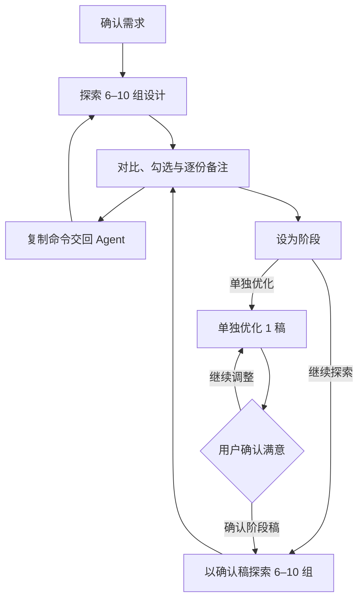

# Lottery Ticket Design

面向 Agent 的多方向 UI 原型设计 skill：每轮探索 **6–10 组设计**，通过勾选、备注和阶段稿持续迭代，最终导出可查看、可编辑的完整 HTML 原型。

[仓库](https://github.com/ryanzen9/Lottery-Ticket-Design) · [Skill 工作流](SKILL.md) · [阶段模式](references/stage-workflow.md) · [设计系统规范](references/design-system-workflow.md)

## 安装

通过 [skills CLI](https://github.com/vercel-labs/skills) 全局安装到 Codex：

```bash
npx skills add https://github.com/ryanzen9/Lottery-Ticket-Design/tree/main --skill lottery-ticket-design --agent codex --global --yes
```

- `--agent codex`：指定 Codex。
- `--global`：在多个项目中使用；移除该参数则安装到当前项目。
- `--yes`：跳过 skills CLI 的确认步骤。

仓库采用根目录 `SKILL.md` 布局，模板和脚本也是运行所需文件。示例显式指定 `main` 分支，使用 Git 路径获取完整资源；当前安装器的根目录缓存快照可能仅安装 `SKILL.md`。可参考 [CLI 安装参数](https://github.com/vercel-labs/skills/blob/main/docs/commands.md)与[缓存路径实现](https://github.com/vercel-labs/skills/blob/main/src/blob.ts)。

运行环境：

- Node.js **22.20+**：运行当前版本的 skills CLI。
- Python **3.10+**：生成、校验、渲染和导出原型；项目脚本使用标准库。
- 支持现代 CSS、JavaScript 与 iframe 的浏览器。
- 源项目通过 CDN 加载 Tailwind CSS v4；生成时的参考研究和 CDN 首次加载需要网络。

## 开始使用

安装后，在支持该 skill 的 Agent 对话中输入：

```text
使用 $lottery-ticket-design，为一个面向产品设计师的团队知识库探索 6 组设计。
需要首页、搜索结果和文档详情，优先考虑桌面端，同时兼顾移动端。
请先结合上下文，用选择项和自定义输入收集需求，确认后再开始设计。
```

Agent 会先确认目标、受众、内容、平台和风格偏好，再研究可追溯的设计参考，生成具有明显差异的方向。每组设计都有稳定的 `P-NNN` 编号、独立文件夹和一个或多个界面。

## 查看、备注与迭代

1. 打开生成项目的 `index.html`，按时间线查看设计；最新批次位于顶部。
2. 点击卡片进入 Bento 设计画板，查看组内界面、设计元数据和可交互的设计系统组件。
3. 勾选方案，在各卡片中填写独立备注，并在顶部填写整体调整要求。
4. 点击 **复制迭代命令**，把命令粘贴给 Agent 执行下一步。

命令会包含项目路径、所选编号、逐份备注、整体要求和设计系统步骤。勾选时也会尝试自动复制编号。浏览器会在允许本地存储时保留选择与备注草稿，取消勾选后可重新恢复备注。

Dashboard 是静态页面；复制命令并交回 Agent 后，由 Agent 写入项目文件、生成新稿和刷新导出包。

## 阶段模式

在卡片或设计详情页点击 **设为阶段**，即可创建 `S-NNN` 阶段。时间线显示阶段标记，侧栏的 **阶段** 菜单可独立查看阶段稿和版本。

| 操作 | 行为 |
| --- | --- |
| 设为阶段 | 将所选设计确认为当前阶段基线，保留此前阶段 |
| 单独优化 | 锁定该阶段最新工作稿，每次生成 **1 个新版本**，保留原稿 |
| 确认阶段稿 | 将满意的工作稿设为已确认稿 |
| 继续探索 | 以已确认阶段稿为共同基线，再生成 **6–10 份方案** |

单稿优化属于阶段内版本，不计为新一轮探索。新优化稿待确认时，先继续优化或确认满意，再进入下一轮。其他勾选方案可在探索模式中作为补充参考，阶段基线保持固定。

阶段选择与确认先保存在浏览器；完整迭代命令携带阶段状态，由 Agent 同步到 `manifest.json`。稿件和阶段选择分别带版本号，避免刷新后旧缓存覆盖较新的项目状态。详细规则见[阶段工作流](references/stage-workflow.md)。



## 设计系统与预览

- 每稿记录 **布局、风格、色彩搭配、元素、动效、字体、交互** 七项元数据，以及参考来源和继承关系。
- 使用 Tailwind CSS v4 的 CSS-first 设计系统，将通用颜色、字体、间距、圆角、主题和组件持久化到该稿的 `design.css`。
- 通过 `style-history.json` 记录草案、锚定版本和 CSS 指纹；后续界面共用已锚定的系统。
- 详情页直接展示色板、字阶、圆角、按钮和表单组件，支持输入、勾选、开关、标签页和局部明暗主题切换。
- Web 预览提供常见桌面视口；移动端提供 iPhone 18 Pro 外观骨架和 `402 × 874` CSS 视口，可打开原始 HTML。

设计系统实现与风格演化步骤见[设计系统工作流](references/design-system-workflow.md)。设备骨架用于浏览器中的原型预览，外观为近似绘制。

## 导出完整原型

总览卡片和详情页均提供 **导出原型** 入口。每稿 ZIP 包含：

- 全部界面的 HTML、CSS、JavaScript、本地素材与设备预览骨架。
- 设计画板、设计系统查看页、`design.css` 和风格记录。
- `metadata.json`：已保存的需求、设计元数据、参考来源、父稿编号、批次反馈、阶段状态和文件指纹。
- Tailwind CSS v4.3.3 本地浏览器运行时及其许可证。
- 查看入口 `index.html`、说明文件和本地预览脚本 `serve.py`。

解压整个文件夹后，打开其中的 `index.html`。涉及 ES 模块、fetch 或根路径资源时，在解压目录运行：

```bash
python3 serve.py
```

然后打开终端显示的本地地址。外部联网资源会在导出入口与元数据中列明；浏览器中尚未交回 Agent 的备注和阶段草稿不属于已保存的导出元数据。便携化调整过的 HTML 会同时保留精确原稿，位于 `originals/`。

## 仓库结构

```text
Lottery-Ticket-Design/
├── README.md
├── SKILL.md                     # Agent 工作流入口
├── agents/openai.yaml           # Skill 展示信息
├── assets/                      # Dashboard、画板、设备与导出模板
│   └── vendor/                  # 导出所用 Tailwind 运行时与许可证
├── references/                  # 设计系统、阶段模式的详细规则
└── scripts/                     # 渲染、风格记录、导出与回归测试
```

Agent 生成的原型项目独立存放：

```text
my-prototypes/
├── index.html
├── manifest.json
├── design.css                   # Dashboard、画板和设备外壳样式
├── prototypes/P-001/
│   ├── index.html               # 该稿设计画板
│   ├── screens/                 # 原型界面
│   ├── viewers/                 # 设备预览入口
│   ├── design.css               # 该稿设计系统
│   ├── style-history.json
│   └── system.html
└── exports/P-001.zip
```

## 开发与维护

克隆仓库：

```bash
git clone https://github.com/ryanzen9/Lottery-Ticket-Design.git
cd Lottery-Ticket-Design
```

从仓库根目录初始化一个空项目：

```bash
python3 scripts/board.py init ../my-prototypes --title "知识库设计" --brief "团队知识库的多方向原型探索"
```

由 Agent 补齐 manifest、各稿设计系统、风格锚定记录和界面后，重新渲染并生成导出包：

```bash
python3 scripts/board.py render ../my-prototypes
```

`init` 只创建空项目，实际界面由 Agent 编写。风格记录使用 `prepare` 和 `anchor`；命令参数可通过 `python3 scripts/board.py --help` 查看，完整操作见 [SKILL.md](SKILL.md)。

运行回归测试：

```bash
python3 -m unittest discover -s scripts -p 'test_*.py'
node --test scripts/test_iteration_handoff.cjs
```

## 第三方资源

导出使用的 Tailwind CSS 浏览器运行时版本为 **4.3.3**，其 MIT 许可证保存在 [assets/vendor/TAILWIND-LICENSE.txt](assets/vendor/TAILWIND-LICENSE.txt)。
